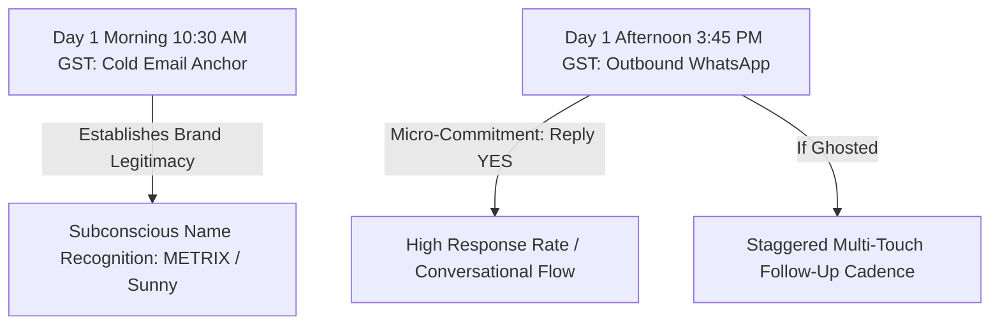

# 🇦🇪 METRIX Dubai Cold Outreach Master Strategy (WhatsApp & Email)

> **Document Classification:** Confidential Operating Playbook & Field Manual  
> **Target Market:** Dubai, United Arab Emirates (GCC Hospitality & Aesthetic Corridors)  
> **Target Profiles:** Founders, Managing Partners, Operations Directors, Heads of Hospitality  
> **Offer Structure:** Complimentary 7-Day In-Store Weekend Pilot ➔ Flat 500 AED / month SaaS License  

---

## 1. Executive Summary & Core Philosophy

In the Dubai hospitality market, standard B2B sales playbooks fail completely. 

Operators in Jumeirah, DIFC, Downtown, and Al Wasl are bombarded daily by amateur agencies offering "social media marketing", "influencer collabs", or "SEO". If you look, sound, or smell like a generic marketing agency, you will be ignored, blue-ticked, or blocked.

METRIX succeeds because it operates as an **In-Store Operating System and Guest Intelligence Platform**. We do not pitch "marketing services"; we pitch **margin reclamation (Anti-Talabat)** and **reputation protection (Real-Time Table Recovery)**.

---

## 2. Timing Architecture: The Dubai Hospitality Clock

Hospitality professionals operate on a radically different rhythm than standard corporate offices. Aligning outreach with their operational clock is the single highest leverage variable for conversion.

### 📅 Optimal Days of the Week

| Day | Rating | Operational Context & Strategy |
| :--- | :--- | :--- |
| **Monday** | ⚠️ Moderate | Weekly inventory reconciliation, staff rotas, management meetings. Send **cold emails only** in late afternoon. |
| **Tuesday** | 🟢 **PEAK (Best)** | Operators are relaxed from the weekend, reviewing last week's revenue/aggregator deductions, and open to operational upgrades. |
| **Wednesday** | 🟢 **PEAK (Best)** | Prime mid-week day. Ideal for initiating WhatsApp touchpoints and scheduling weekend pilots. |
| **Thursday** | 🟢 **HIGH** | Final operational prep before the weekend rush. Perfect for pitching: *"Let's test this free for this Friday night's service."* |
| **Friday** | 🔴 **STRICT BAN (Post-12 PM)** | Holy day prayers + start of weekend dining rush. Absolute chaos in kitchens. Never send cold outbound on Friday afternoon/night. |
| **Saturday** | 🔴 **STRICT BAN** | Peak foot traffic day in Dubai. Managers are physically on the floor running tables. |
| **Sunday** | 🟡 Special | Sunday late evening (10:00 PM – 11:30 PM GST) is viable for register closing reviews, but weekday mornings are safer. |

---

### ⏰ The 2 Daily Outreach Windows (GST = Gulf Standard Time / UTC+4)

> [!IMPORTANT]
> *Note on Timezones:* Dubai is on **GST (UTC+4)**. If you are operating from India (IST = UTC+5:30), Dubai is **1 hour and 30 minutes behind you**.  
> *(e.g., 3:45 PM GST = 5:15 PM IST).*

#### 🟢 Window 1 (The Golden Lull): 3:30 PM – 4:45 PM GST (5:00 PM – 6:15 PM IST)
* **Why it works:** Lunch service ends around 3:00 PM. Floor staff are clearing tables, kitchens are cleaning, and dinner service prep does not kick in until 5:30 PM. Founders, managing partners, and operations leads sit down in the back office with an espresso to check their personal phones.
* **Best For:** Initial WhatsApp Outbound (Script 1 / Script 2) and 24h follow-ups.

#### 🟢 Window 2 (The Register Closing Lull): 10:30 PM – 11:30 PM GST (12:00 AM – 1:00 AM IST)
* **Why it works:** Service is ending, final table bills are settled, and managers are closing out POS cash registers. They see the painful total deducted by Talabat/Deliveroo on the end-of-day report.
* **Best For:** Follow-up bumps and margin-shock stats.

#### 🔴 The "Suicide Windows" (Never Message During These Hours)
* **11:30 AM – 2:30 PM GST:** Dubai lunch rush.
* **7:00 PM – 10:00 PM GST:** Dubai peak dinner rush.

---

## 3. The Channel Strategy: WhatsApp vs. Email (Both or Single?)

### ❓ The Dilemma: Should You Blast Both at Once?
**NO.** Blasting the exact same message on WhatsApp and Email simultaneously at the exact same minute looks like an automated mass bot attack. It triggers defensive walls and gets you flagged as spam.

### 🎯 The Winning Play: The "Surround Sound" Orchestration

Instead of competing against each other, **Email acts as the Corporate Anchor**, while **WhatsApp acts as the Direct Closing Engine**.



#### Why This 2-Channel Progression Beats Single-Channel:
1. **Email Provides Institutional Trust:** Independent operators receive hundreds of sketchy WhatsApp scams. When they receive a professional email from `sunny@metrixmedia.agency` (custom domain, corporate footer, clean typography), it proves you are a legitimate technology provider.
2. **WhatsApp Provides Immediate Action:** Dubai operators check emails 2–3 times a day, but they check WhatsApp **50+ times a day**. When your WhatsApp ping arrives in the 3:45 PM lull, they recognize the name *"METRIX"* from the morning's subject line and reply in seconds.

---

## 4. The Complete 14-Day Outreach Cadence

Here is the exact day-by-day protocol to run on every batch of 20 target Dubai leads:

### 📍 Day 1 (Tuesday): The Orchestrated Double Strike
* **10:30 AM GST:** Send **Cold Email Anchor** via `sunny@metrixmedia.agency` (matching Script 1 or Script 2 angle).
* **3:45 PM GST:** Send **Primary WhatsApp Message** (Script 1: *Anti-Talabat* OR Script 2: *Floor Recovery & VIP Loyalty*).
  * *CTA Rule:* End strictly with: `Reply "YES" and I'll send over a live 60-second demo to your phone!`

#### 📱 Script 1: The Margin Recovery / Anti-Talabat Angle (For Takeaway / Delivery Venues)
```whatsapp
You pay the rent in [Area]. You pay the staff salaries, the kitchen prep, and the overhead.

And then Talabat swoops in and takes a full 30% right off the top.

*That is completely unfair.*

You take all the financial risk, you absorb the food waste, and you battle the daily competition—you deserve 100% of your revenue, not 70%.

This is what METRIX solves.

We deploy a direct WhatsApp ordering engine for your venue. Diners order direct, the money goes straight to your bank account, and you keep 100% of the ticket. We power the software and connect with on-demand delivery fleet APIs—your kitchen just packs the food.

While Talabat taxes you 30% on every single order, METRIX operates at a flat, predictable monthly rate—saving you thousands in commissions every month.

Want to see how this works for [Venue Name]? 

Reply *"YES"* and I'll send over a live 60-second demo to your phone!
```

#### 📱 Script 2: The Floor Recovery & VIP Loyalty Angle (For Dine-In & High-Dwell Venues)
```whatsapp
99% of diners have an amazing experience at [Venue Name].

But that 1%...
- An order is delayed during peak rush.
- A coffee is served lukewarm.
- An unhappy diner says "everything was fine" to the waiter, leaves silently, and posts a permanent 1-star review on Google Maps 3 hours later.

In prime Dubai corridors like [Area], a single drop in your Google Maps rating directly diverts foot traffic to nearby competitors. A rare human error should never define your venue's reputation.

We engineered METRIX as a real-time dining recovery protocol:
1. Diners tap a luxury tabletop asset at their table to call service or note dining feedback.
2. If any table needs attention or notes food temperature, management receives a WhatsApp alert within 3 seconds with the exact table number.
3. Your team attends to the table and resolves the issue in person before the diner ever asks for the bill.
4. Happy diners unlock VIP birthday privileges and can access your Google Maps page directly.

Want to see how this works for [Venue Name]?

Reply *"YES"* and I'll send over a live 60-second demo to your phone!
```

---

### 📍 Day 2 (Wednesday - 24 Hours Later): Touch 1 (The Micro-Math Shock)
* **3:45 PM GST:** If they read your WhatsApp (blue tick) or left it unread, send Touch 1:
  * *For Script 1:* The Weekend 1,260 AED delivery commission calculation.
  * *For Script 2:* The "Diner Lie" psychology (*"95% of diners say 'everything's great' to the waiter then post 1 star on Google"*).

---

### 📍 Day 5 (Monday - 120 Hours Later): Touch 2 (The Mechanism Explainer)
* **4:15 PM GST:** Send Touch 2 on WhatsApp + 1-Line Threaded Email Reply:
  * *For Script 1:* The "Ghost Fleet" explainer (*"Zero bikes needed; Careem/Yango courier API handles dispatch"*).
  * *For Script 2:* The "Google SEO Cliff" stat (*"Dropping from 4.5 to 4.2 drops local search foot traffic by 28%"*).
* **Email Thread:** Reply to your Day 1 email with:
  > *"Hi [Name], sent a quick breakdown of your venue's delivery margins over WhatsApp. Let me know if you had 30 seconds to tap through the [Venue Name] mobile simulation."*

---

### 📍 Day 8 (Thursday - Pre-Weekend Pilot Offer): Touch 3 (The Visual Proof Drop)
* **4:00 PM GST:** Send a direct link to their pre-built simulator or a short 15-second WhatsApp Voice Note:
  * WhatsApp Message:
    > *"Hey [Name]—I set up [Venue Name]’s live tabletop companion so you can test the diner experience in 30 seconds before weekend service:  
    > 👉 https://metrixmedia.agency/portal.html?name=[Venue+Name]  
    > Test 1-tap table service calling (water, waiter, bill in <3s) and VIP dining club data capture. Takes 30 seconds on your phone right now!"*

---

### 📍 Day 12–14 (Tuesday): Touch 4 (The Sovereign Break-Up)
* **4:30 PM GST:** Send the final Break-Up on WhatsApp.
  * *Why this works:* Operators suffer from severe FOMO (Fear Of Missing Out). Taking the offer off the table consistently produces a **35–45% delayed recovery reply rate**.
  * Message:
    > *"Hey [Name]—assuming guest intelligence and margin recovery isn't a priority for [Venue Name] right now, which is completely fine!  
    > I'll stop following up so your team can focus on service. If you ever want to run a 7-day test to capture diners and stop aggregator commission, feel free to reach back out anytime.  
    > Wishing you guys massive success with service!"*

---

## 5. Unfair Strategic Add-Ons (Execution Excellence)

### 🛡️ 1. WhatsApp Account Warming & Anti-Ban Architecture
* **Daily Volume Cap:** Never send more than **20 to 25 new outbound cold WhatsApp messages per day** from a single number.
* **The "No Raw Links on Step 1" Rule:** Meta's spam filters aggressively track accounts that send external links in the very first cold message to an unsaved contact. By closing Script 1 and Script 2 with `Reply "YES"`, the lead sends the first reply, turning the chat into an **opt-in two-way conversation**. When you subsequently send the demo link, WhatsApp's spam algorithm treats it as 100% compliant and will never ban your number.
* **Spacing Buffer:** Insert a 2 to 4 minute pause between manual messages. Never use cheap automated WhatsApp blasters that send 100 messages in 60 seconds.

---

### 👔 2. WhatsApp Business Profile Optimization
Your WhatsApp Business profile must radiate institutional authority:
* **Profile Picture:** The official METRIX Sovereign Emblem (`metrix_logo.jpg` - brushed champagne gold chevron monogram on obsidian black).
* **Business Name:** `METRIX Technologies`
* **Category:** `Software Company` / `Hospitality Service`
* **Bio / Description:** `In-Store Guest Intelligence & Direct Dining Operations Platform. Deploying across Dubai's premier hospitality corridors.`
* **Email:** `sunny@metrixmedia.agency`
* **Website:** `https://metrixmedia.agency`

---

### 🤝 3. The "Voice Note" Secret Weapon (Touch 3)
In Dubai, where business is deeply relational, text messages can feel transactional. A 12-to-15-second casual, confident WhatsApp Voice Note on Day 5 or Day 8 cuts through 100% of vendor noise.
* **Script:**  
  *(Hold mic, confident low tone, no rush):*  
  > *"Hey [Name], Sunny here—just leaving a quick note while checking out [Venue Name]’s menu online. Honestly, we built this specifically so independent venues in [Area] don't have to give up 30% to delivery apps after working 14 hours in the kitchen. If you want to test our direct WhatsApp ordering this weekend—free for 7 days, zero contracts—let me know and I'll ping the live link over. Talk soon."*

---

### 📊 4. CRM Routine & Daily Workflow
1. **Morning (10:00 AM – 11:30 AM GST):** Open [`leads_tracker.html`](file:///C:/Users/sunny/Desktop/leads_tracker.html), check the **"Follow-Up Due"** column, and queue the morning emails.
2. **Afternoon (3:30 PM – 4:45 PM GST):** Execute the WhatsApp batch (Send Script 1/2 to new leads; send Touch 1/2/3/4 follow-ups to existing leads using the 1-click copy buttons).
3. **Evening (10:00 PM – 11:00 PM GST):** Check for *"YES"* replies, deliver customized demo links, and move converted leads into **"Active 7-Day Pilot 🚀"**.
