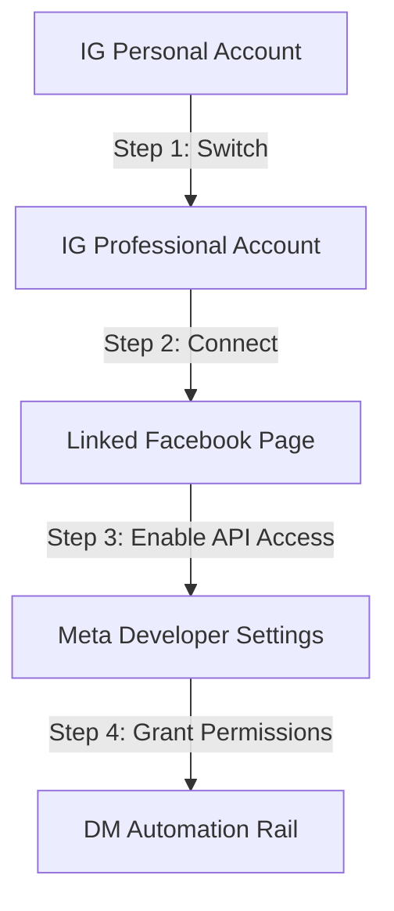
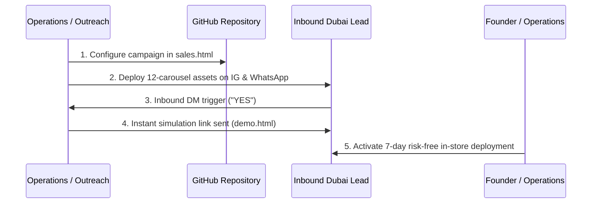

# 🗺️ Instagram Automation & Collaborative Control Roadmap
**Target Audience**: METRIX Leadership & Operations  
**Objective**: Establish a secure, high-converting, automated lead acquisition funnel via Instagram DM triggers for the **METRIX Guest Intelligence & D2C Ordering Engine**, governed by a strict brand compliance and testing workflow.

---

## 📌 Executive Summary
To scale client acquisition for **METRIX** across Dubai hospitality venues, we deploy a conversational Instagram funnel. When local restaurant, cafe, and clinic operators engage with our direct-response carousels and DM trigger keywords, automation instantly routes them to our live interactive simulator (`demo.html`) to experience table resolution and VIP data capture in real-time.

This roadmap details:
1. **Infrastructure**: Linking Instagram to Meta APIs and automation rails.
2. **Technical Integration**: Directing high-intent leads to the live simulator (`demo.html`) and campaign studio (`sales.html`).
3. **Control Workflow**: Strict operational approval loop to ensure 100% brand sovereignty, zero review gating, and pure digital delivery standards.

---

## 🛠️ Phase 1: Meta API Setup
To enable automated messaging, the `@METRIX` Instagram account must be linked to Meta’s Business Manager.

### Step 1: Instagram Account Optimization
1. Switch account to **Professional / Business Account**.
2. Set the business category to **Software / SaaS Platform** (or *Technology Company*).
3. Ensure profile displays: **METRIX | In-Store Guest Intelligence & Review Protection Platform**.

### Step 2: Link Facebook Page
1. Link to the official **METRIX (A ONEGRV Enterprise)** Facebook business page.
2. Verify domain verification status for `metrixmedia.agency`.

### Step 3: Enable Direct Message API Access
1. In Settings & Privacy &rarr; Messages and Story Replies &rarr; Message Controls &rarr; Toggle **Allow Access to Messages** to ON.

---

## 🔗 Phase 2: Live Simulator & DM Funnel Integration

### 1. Trigger Words Setup
Keyword trigger rules for incoming DMs:
* `YES` (Universal CTA across all cold outreach & carousel slides)
* `CAFE` (Specialty Coffee & Bistro owners)
* `TALABAT` (Venues seeking direct D2C ordering)
* `CLINIC` (Aesthetic clinics & medical wellness centers)

### 2. Conversational Redirect (1-Step Flow)
Once triggered, the automated response fires instantly:
> *"Hey there! 🥂 Here is your live 60-second interactive simulation showing how METRIX protects your dining room and captures repeat VIPs:*
> 
> *👉 https://metrixmedia.agency/demo.html?name=Your+Venue*
> 
> *Try tapping 2 stars to see how an instant WhatsApp service alert notifies management in 3 seconds before the diner ever leaves your door!"*

* **Target Link**: `https://metrixmedia.agency/demo.html`
* **Offer**: Complimentary 7-Day Risk-Free In-Store Deployment (Backed by 100% Money-Back Guarantee). Flat 500 AED / month.

### 3. Pure Digital Fulfillment Architecture
* **Asset Specs**: Bespoke 300 DPI ultra-high-resolution print-ready digital vector assets (PDF/SVG).
* **Tabletop Hardware Fit**: Strictly formatted for 100mm × 155mm acrylic standees, wooden clips, table tents, and check presenters.
* **Instant Delivery**: 100% digital fulfillment via secure cloud download link or email. Zero physical shipping, zero customs delays, zero courier fees.

---

## 🤝 Phase 3: Collaborative Approval Workflow

### Core Compliance Checklist Before Deployment:
- [x] **Zero Review Gating**: Public Google review access remains 100% transparent and accessible across all portals.
- [x] **No Physical Hardware Shipping**: Pure digital delivery of 300 DPI vector assets.
- [x] **No "Counter" Terminology**: Standees are strictly tabletop displays placed on dining and lounge tables.
- [x] **No "GM" Terminology**: Target Management, Floor Teams, and Operations.
- [x] **Universal Pricing**: Flat 500 AED / month SaaS license.
